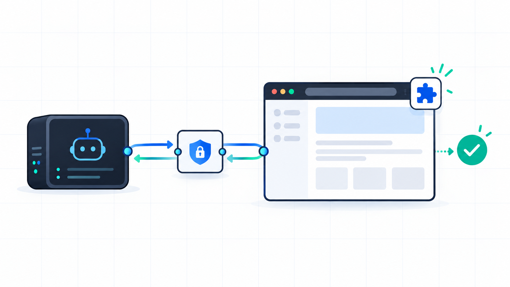
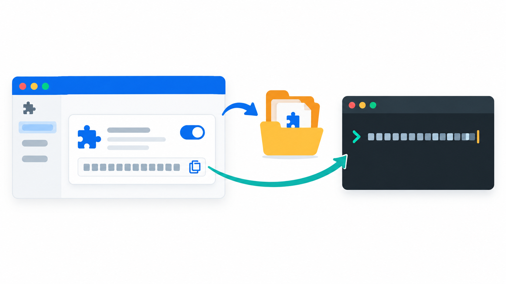

# Chrome Controlla

Controlla can wait for bounded visual regions to settle through `ready_when: {"kind":"visual_stable",...}` or workflow step `{"kind":"wait_stable",...}`. It hashes normalized pixels, verifies the same active document on each sample, and returns an incomplete timeout without dispatching a mutation. `browser action=describe` includes a compact route manifest. If no existing tab is a safe match, use its bounded candidate/reason receipt and open the exact requested URL in a new Controlla-owned tab, or request an exact tab selection when an existing tab is required. See [native desktop fallback limits](docs/desktop-fallback.md) and the [roadmap](docs/ROADMAP.md).

Chrome Controlla is a Chrome-only browser MCP for agents that need fast, verifiable browser control. It connects an MCP client to an unpacked Manifest V3 extension through Chrome Native Messaging, keeps an exact tab identity, and returns action plus verification evidence.

The current V3 server exposes six tools:

`browser` · `snapshot` · `act` · `workflow` · `extract` · `verify`



## Install in five minutes

The supported local setup has two pieces that must come from the **same checkout**:

1. The native host and V3 MCP executable.
2. The unpacked Chrome extension loaded from `extensions/chrome-controlla`.

The extension ID is installation-specific. Register the exact ID Chrome shows for your loaded extension; never copy an ID from a README, another machine, or another checkout.

### 1. Download the source

Clone the repository and enter it:

```sh
git clone https://github.com/Praket7/chrome-controlla.git
cd chrome-controlla
```

To use a downloaded source archive instead, open the GitHub **Code** menu, choose **Download ZIP**, unpack it, and run every command from the unpacked repository root. Do not select the parent `extensions` folder in Chrome; the folder you load must directly contain `manifest.json`.

### 2. Install prerequisites

- Chrome 132 or later (the extension uses Chrome’s frozen-tab lifecycle signal).
- Rust 1.99.0 with Cargo.
- Node.js 24.19.0 or later.

Build the release binaries:

```sh
cargo build --locked --release -p controlla-runtime --bins
```

This creates:

- `target/release/controlla` — native-host registration and legacy CLI commands.
- `target/release/controlla-v2` — the current six-tool V3 MCP (`mcp` subcommand).

### 3. Load the extension

1. Open `chrome://extensions`.
2. Turn on **Developer mode**.
3. Click **Load unpacked**.
4. Select `<checkout>/extensions/chrome-controlla`.
5. Approve `webNavigation` if Chrome asks.
6. Copy the exact extension ID displayed on the extension card.



The selected folder must look like this:

```text
<checkout>/extensions/chrome-controlla/manifest.json
<checkout>/extensions/chrome-controlla/background.js
<checkout>/extensions/chrome-controlla/popup.html
```

### 4. Register the native host

Run this from the same checkout used to build the binaries. Replace `YOUR_EXTENSION_ID` with the ID copied from Chrome:

```sh
"$PWD/target/release/controlla" install-bridge YOUR_EXTENSION_ID
```

The command writes Chrome's native-host manifest. On macOS it is normally:

```text
~/Library/Application Support/Google/Chrome/NativeMessagingHosts/chrome_controlla_bridge.json
```

Check that the manifest contains both of these exact values:

```json
{
  "path": "/absolute/path/to/this/checkout/target/release/controlla",
  "allowed_origins": ["chrome-extension://YOUR_EXTENSION_ID/"]
}
```

On Linux, the manifest is written under the Chrome NativeMessagingHosts directory in your user configuration. On Windows, use the `.exe` path and the native-host registration produced by the same `install-bridge` command. If you move the checkout or reload an extension whose ID changed, run `install-bridge` again.

### 5. Configure your MCP client

Use an **absolute** path to `target/release/controlla-v2`, not `target/release/controlla`:

```json
{
  "mcpServers": {
    "chrome-controlla": {
      "command": "/absolute/path/to/chrome-controlla/target/release/controlla-v2",
      "args": ["mcp"],
      "env": {
        "CONTROLLA_STATE_DIR": "/absolute/path/to/chrome-controlla-state"
      }
    }
  }
}
```

Use a different absolute `CONTROLLA_STATE_DIR` for each concurrently running MCP process. Restart or reload the MCP client after changing its configuration.

For Codex, use the local MCP configuration UI or generated configuration from the checkout:

```sh
node integrations/codex-config.mjs \
  "$PWD/target/release/controlla-v2" \
  "$HOME/.chrome-controlla"
```

The generated entry must launch `controlla-v2 mcp`. After restarting Codex, the live tool list should contain exactly `browser`, `snapshot`, `act`, `workflow`, `extract`, and `verify`.

## Reload order after a change

When you rebuild or change the extension:

1. Rebuild the binaries if Rust code changed.
2. Reload the extension from `chrome://extensions`.
3. Re-run `install-bridge` if the checkout path or extension ID changed.
4. Restart or reload the MCP client.
5. Confirm the six V3 tools are present before attempting a browser action.

A successful tool list only proves that the MCP process started. It does not prove that Chrome is connected. Run `browser` `describe` or `discover_shared_tabs` and select a tab from fresh evidence.

## Download and build a local package

There is no universal cross-platform binary. Packages are host-specific and must be built on the target OS and CPU architecture.

Build and validate the npm package:

```sh
./scripts/package-build.sh
./scripts/package-check.sh
```

The staged package is written under `packages/chrome-controlla/dist`. Install it into a private prefix:

```sh
npm install --prefix "$HOME/.local/share/chrome-controlla" \
  "$PWD/packages/chrome-controlla/dist"
```

Then configure the installed launcher:

```text
$HOME/.local/share/chrome-controlla/bin/controlla mcp
```

The package launcher routes `controlla mcp` to the six-tool V3 MCP and keeps setup commands such as `install-bridge` available. The package includes the local ChatGPT plugin under `node_modules/chrome-controlla/plugin`.

## First connection check

After Chrome and the MCP client are running:

1. Confirm the six V3 tools are listed.
2. Use `browser` `describe` to confirm the active policy.
3. Use fresh discovery or a fresh snapshot to choose an exact tab.
4. Run one bounded `workflow` for a known multi-step task.
5. Use `verify` for the requested postcondition.
6. Release the Controlla session when finished. Releasing detaches tabs; it does not close the user's tabs.

For ordinary tasks, do not probe schemas or legacy discovery tools. Use the supplied V3 schemas directly. Use recovery APIs only after a real error or context transition.

## Troubleshooting

### “Native tab inventory is stale”

- Confirm the extension is enabled.
- Confirm the native-host `allowed_origins` exactly matches the current extension ID.
- Confirm the manifest `path` points to the current checkout's executable.
- Reload the extension, then restart the MCP client.
- Make sure no second MCP process is using the same `CONTROLLA_STATE_DIR`.

### Chrome refuses “Load unpacked”

Select the directory containing `manifest.json` itself:

```text
<checkout>/extensions/chrome-controlla
```

Do not select the repository root, the `extensions` parent directory, or a nested ZIP directory. If Chrome still shows an older copy, remove the old extension card and load the directory again.

### The MCP starts with the wrong tools

The client is probably launching the legacy binary. Change the command to:

```text
<checkout>/target/release/controlla-v2
```

with argument `mcp`, then restart the client.

### Pairing rejects a tab

Rediscover, select the exact decimal Chrome tab IDs from the fresh result, and pair with that result's `host_id`. Do not reuse an old snapshot after navigation, tab replacement, or a window transition.

### A second MCP process cannot start

Give it a different absolute state directory. State directories are process-owned and are not interchangeable.

## Documentation map

- [Installation and agent guide](docs/quickstart.md) — shortest source-checkout setup and efficient task pattern.
- [Client configuration](docs/clients.md) — Codex, Freebuff, OpenCode, Claude Code, ChatGPT Desktop, and package setup.
- [Browser-control skill](packages/chrome-controlla/plugin/skills/browser-control/SKILL.md) — full tool contract and recovery rules.
- [Verification matrix](docs/verification-matrix.md) — local test evidence and live qualification boundaries.
- [Release notes](docs/release/notes.md) — packaged changes and release guidance.

## Build and test

```sh
cargo fmt --all -- --check
cargo clippy --workspace --all-targets --locked -- -D warnings
cargo test --workspace --locked
./scripts/check-dependencies.sh
./scripts/package-check.sh
npm run check:docs
```

The current local package evidence covers macOS arm64. Build and validate a separate archive on each release-matrix operating system and CPU architecture.

## License

See [LICENSE](LICENSE) and [NOTICE](NOTICE).
